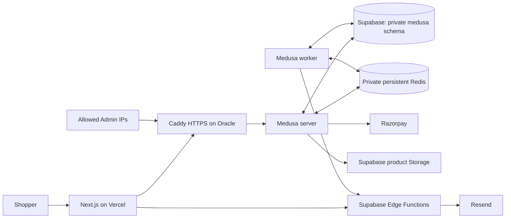

# BAETEE deployment

**Target:** Next.js on Vercel; Medusa Admin/API, worker and Redis on one Oracle Cloud VM; PostgreSQL, product Storage and mail Edge Functions on Supabase. Resend delivers email; Razorpay processes payments.

**Status:** deployment files and application configuration are prepared. No cloud resources have been created, no production data has been migrated, and no hosted purchase/email test has run. Docker Engine is inaccessible from the current workspace, so the actual Linux/ARM image build, Caddy configuration and hosted connection checks must run on the VM before launch. Owner inputs are listed in [deployment-needed.md](deployment-needed.md).

**Verified locally (14 October 2026):** storefront and backend/Admin builds, both TypeScript checks, 16 backend tests, private-schema migration integration in a disposable empty database, Compose configuration validation and storefront HTTP/cart/gate checks passed. Lint has zero errors and the existing 12 image warnings. The dependency advisory audit and actual Docker/Oracle/Supabase/payment/mail checks remain pending.

## 1. Architecture and costs



The browser receives catalog data and an HTTP-only cart cookie. It never receives the PostgreSQL connection string, Admin credential, service-role key, S3 secret or Razorpay secret.

- Oracle currently documents **2 OCPUs and 12 GB total** for Always Free Ampere A1, and 200 GB combined boot/block storage. Use one Ubuntu ARM64 A1 VM within the allowance shown in your tenancy. The 1 GB micro VM is too small for this build and two Medusa processes. Capacity is not guaranteed and idle free VMs may be reclaimed; use monitoring and off-VM backups. Verify the Console estimate before creating anything. [Oracle Always Free resources](https://docs.oracle.com/en-us/iaas/Content/FreeTier/freetier_topic-Always_Free_Resources.htm)
- This is a commercial store. Vercel Hobby is restricted to personal non-commercial use; select an eligible paid plan. [Vercel Hobby](https://vercel.com/docs/plans/hobby)
- Supabase Free projects can pause after low activity over seven days; free projects need independently exported backups. Choose a plan and recovery policy suitable for actual orders. Storage, bandwidth, mail, gateway charges and a domain can also cost money. [Supabase pausing](https://supabase.com/docs/guides/platform/free-project-pausing), [backups](https://supabase.com/docs/guides/platform/backups), [pricing](https://supabase.com/pricing)

The Oracle files support native ARM64 or AMD64 builds. Use a maintained Ubuntu 24.04 image and Node 24 inside Docker. Vercel uses the repository's Node 22 setting. Each platform installs from its committed lockfile.

## 2. Choose URLs and prepare the source

Examples below use `https://www.example.com` for the store and `https://api.example.com` for Medusa/Admin. Replace them with your final values everywhere. Medusa Admin will be at `https://api.example.com/app`.

1. Put the source in a private Git repository and connect that repository to Vercel. Review ignored files before committing. Never commit real `.env`, `backend.env`, `redis.conf`, certificate directories, backups or SSH keys.
2. Create the Vercel project with the **repository root** as Root Directory, Next.js as the framework and Node 22. `vercel.json` supplies `npm ci` and the build command. `.vercelignore` excludes backend/deployment/private environment files from CLI uploads. For Git deployments, only the root dependencies are installed; backend secrets must never be committed.
3. Add the store domain in Vercel and follow its DNS instructions. Choose one canonical storefront origin and redirect the alternate hostname to it. `PUBLIC_STORE_URL` must match the browser's origin exactly.
4. Create the Oracle VM, allocate its public IP, and point the API hostname's A record to that IP. Add AAAA only if VM/container IPv6 connectivity is configured and tested. Keep the API record **DNS only** while using the supplied Caddy IP restrictions; a proxy would change the remote IP Caddy sees.
5. The Docker Admin bundle includes the API URL at build time. Rebuild the image if the API hostname changes.

## 3. Create Supabase database access

Use a fresh project near the Oracle home region. Medusa uses SQL connections to PostgreSQL; Supabase Auth is not used for Medusa Admin accounts.

Use a project without existing Medusa tables/types in `public` or another schema. Some upstream initial migrations inspect `public` tables or global enum names; a second fresh installation beside an existing Medusa installation in the same database needs a separate reviewed migration path. The local private-schema integration check therefore uses a disposable, empty local database.

1. Run [deploy/supabase-medusa.sql](deploy/supabase-medusa.sql) in the Supabase SQL editor. It creates the limited `baetee_medusa` login role and private `medusa` schema, and revokes Data API role access.
2. Set a unique password for `baetee_medusa` privately. One option is an administrator `psql` session using the interactive `\password baetee_medusa` command. Do not save the actual password in source files or shell history.
3. In **Connect**, copy the actual **session pooler** endpoint on port **5432**, using username `baetee_medusa.PROJECT_REF`. This supports an IPv4 VM/container network. A direct connection can be used instead when container IPv6 is verified; its username is `baetee_medusa`.
4. **Do not use transaction pooling/port 6543.** The refund ledger holds session advisory locks across multiple statements and a gateway request. Transaction pooling cannot preserve that connection ownership. The application rejects the usual transaction-pool port. [Supabase connection modes](https://supabase.com/docs/guides/database/connecting-to-postgres)
5. Download the database CA certificate from Supabase Database SSL settings and save it as `deploy/oracle/certs/supabase-ca.crt` on the VM. Set `DATABASE_SSL=true` and `DATABASE_CA_CERT=/run/certs/supabase-ca.crt`. Certificate and hostname verification remain enabled. Remove `sslmode`, `sslrootcert` and `options` URL query parameters; the application configures these itself. Enable SSL enforcement in Supabase. [SSL enforcement](https://supabase.com/docs/guides/platform/ssl-enforcement)
6. Keep `medusa` **out of Data API exposed schemas**. Leave the public quota RPC available for the service-role caller. Private commerce tables need no browser access or public RLS policies. [Supabase schemas](https://supabase.com/docs/guides/api/using-custom-schemas)

Production requires `DATABASE_SCHEMA=medusa`; local Docker development continues using `public`. Start with `DATABASE_POOL_MAX=5` per Medusa process, plus up to three refund connections per process and temporary CLI connections. Check the project's actual connection limit before increasing processes or pool sizes. Session mode holds an underlying database connection for each active client.

### Data migration choice

For a fresh staging database, the seed creates the original 15 tees/90 variants and 30 unpriced commissions. It does **not** copy current local Admin edits, accounts or carts. Before production, decide whether to import the current local data or start with the approved original catalog. Preserve any wanted Admin edits through a reviewed export/import; do not restore the local `public` schema over Supabase's `public`, `auth` or `storage` schemas. Production imports and fresh seeds are separate paths.

## 4. Prepare product Storage and email

1. Create the Supabase public bucket `baetee-products` for intentionally public product images. Keep private documents/customer files elsewhere. Set S3 access credentials, project region, S3 endpoint and public file URL from the Supabase dashboard. [Supabase S3 authentication](https://supabase.com/docs/guides/storage/s3/authentication)
2. Put all six `S3_*` values in the VM's `backend.env`. The S3 access key is different from the Supabase service-role key. Do not create anonymous upload/write policies. Test an authenticated Admin upload and public read after deployment.
3. Apply these SQL files **in order** in the SQL editor:
   - `supabase/migrations/20261010_commission_rate_limit.sql`
   - `supabase/migrations/20261014_commission_hardening.sql`
4. Using the Supabase CLI from the repo root, link the intended project, then deploy:

```bash
supabase login
supabase link --project-ref YOUR_PROJECT_REF
supabase functions deploy send-commission
supabase functions deploy send-order
```

5. Add function secrets in Supabase: `EMAIL_FUNCTION_TOKEN`, `RESEND_API_KEY`, `EMAIL_FROM`, `COMMISSION_RECIPIENT`, `ORDER_RECIPIENT`. Use a verified Resend sender domain and configure its requested DNS records. Both functions authenticate the shared token themselves; `supabase/config.toml` deliberately disables gateway JWT checks for them.
6. Use the **same** `EMAIL_FUNCTION_TOKEN` on Supabase, Oracle and Vercel. Keep all delivery flags false until a private owner/customer delivery test succeeds.

## 5. Prepare the Oracle VM

Install Docker Engine and the Compose plugin using [Docker's Ubuntu instructions](https://docs.docker.com/engine/install/ubuntu/). Enable Docker on boot. Docker group membership gives root-level host access; use a trusted deployment account.

Configure Oracle NSG/security-list rules and the host firewall:

| Port | Allowed source |
|---|---|
| TCP 22 | Your trusted SSH IP/VPN only |
| TCP 80 and 443 | Public internet for HTTPS and certificate issuance |
| UDP 443 | Optional public HTTP/3 |
| 9000, 6379, 5432 | No public ingress |

Allow outbound DNS, HTTPS to payment/storage/mail services and PostgreSQL to the Supabase endpoint. Docker publishes only Caddy's ports; Redis and Medusa are on the private Compose network. Docker-published ports can bypass UFW rules, so enforce the Oracle network rules as well. Keep the existing SSH session open while adjusting firewall access.

Clone the private repository onto the VM, then:

```bash
cd /YOUR/CHECKOUT/baetee/deploy/oracle
umask 077
cp .env.example .env
cp backend.env.example backend.env
cp redis.conf.example redis.conf
mkdir -p certs
```

Edit these files privately:

- `.env`: actual `API_DOMAIN`, certificate-contact `ACME_EMAIL`, immutable `RELEASE_TAG` such as a commit hash, and `ADMIN_ALLOWED_CIDRS` containing your public IPv4/IPv6 CIDRs, separated by spaces. The sample CIDR is not a usable owner IP. Caddy restricts `/app`, `/admin` and `/auth` to these IPs. Store routes and payment webhooks remain public. Changing your Admin IP requires updating this value and recreating Caddy.
- `backend.env`: database URL, all required origins/storage settings, application secrets, Redis URL and any supplied integration keys. URL-encode database passwords. Compose env files treat `$` as interpolation; single-quote values that contain literal `$`. Use hexadecimal generated secrets to simplify this.
- `redis.conf`: replace the sample `requirepass` value with a separate random hexadecimal password and use the same password in `REDIS_URL`. AOF persistence and `noeviction` are configured for jobs, workflow state and locks. The 512 MB Redis cap leaves room for Medusa; monitor Redis memory and disk.
- `certs/supabase-ca.crt`: the downloaded CA certificate, readable by the container's `node` user. The certificate is public trust material, not a private key; mode 644 is appropriate. Keep secret env/config files mode 600; protect their parent directory.

Generate each secret independently, for example `openssl rand -hex 32`. Do not reuse local development secrets. Secret values are runtime files, not Docker build arguments or image layers.

The Redis container runs as UID 999. After editing, grant that container user read access to the mounted secret config while keeping it private:

```bash
chmod 600 .env backend.env
sudo chown 999:1000 redis.conf
sudo chmod 600 redis.conf
chmod 644 certs/supabase-ca.crt
```

Use `sudoedit redis.conf` for later edits. Keep the checkout/deployment directory private to the deployment account; the container mount reads the individual file directly. The image's Redis UID/GID are defined in its [official Dockerfile](https://github.com/redis/docker-library-redis/blob/master/7.4/alpine/Dockerfile); recheck ownership if changing the Redis image family.

## 6. Build, migrate and start Medusa

From `deploy/oracle` on the VM:

```bash
docker compose config --quiet
docker compose build server
docker compose up -d --wait redis
docker compose run --rm --no-deps server npm run migrate
# Fresh staging/approved fresh catalog only:
docker compose run --rm --no-deps server npm run seed
docker compose run --rm --no-deps server npm run preflight:production
docker compose up -d --wait server worker caddy
docker compose ps
curl --fail https://YOUR_API_DOMAIN/health
```

`server` and `worker` use the same image tag; one build is sufficient. The Dockerfile installs production runtime dependencies in `.medusa/server`. `npm run migrate` runs both Medusa migrations and the durable refund-ledger migration using the private schema and verified TLS. **Migrations run before either app process starts.** Stop a failed release here; do not start the apps after a failed migration/preflight. Caddy needs working DNS and reachable ports 80/443 to issue its certificate. [Medusa deployment guide](https://docs.medusajs.com/learn/deployment/general), [Caddy HTTPS](https://caddyserver.com/docs/automatic-https)

Production preflight verifies database TLS, role, schema, restricted grants and the refund table. It does not certify storage, Redis persistence, exposed-schema dashboard settings or payment/email behavior. Verify those separately.

Before transferring the release, the optional local check `cd backend && npm run verify:schema` verifies Medusa and refund migrations in an empty temporary local database/private schema, confirms no tables were created in `public`, and deletes that test database. It requires the local Docker PostgreSQL development role to have database-creation permission. It never runs against a hosted database.

### First Admin account

On the trusted VM terminal, generate a private invitation:

```bash
docker compose run --rm --no-deps server npx medusa user --email YOUR_ADMIN_EMAIL --invite
```

The command prints a sensitive one-time invitation token. Open `https://YOUR_API_DOMAIN/app/invite?token=...` from an allowed Admin IP and set a new password there. Do not copy the token into this repository, chat, tickets or deployment logs. Enable Admin MFA if available in the deployed version. Never reuse the password previously exposed in chat.

### Get storefront connection values

In Admin, inspect the **India** region and **BAETEE storefront** publishable API key. The key must be linked only to **BAETEE Online**. Copy the new production region ID and publishable key into Vercel; local IDs/keys belong to the local database and will not work here.

## 7. Configure and deploy Vercel

Set these environment variables for the intended production deployment, then redeploy:

| Variable | Value/source |
|---|---|
| `MEDUSA_BACKEND_URL` | `https://YOUR_API_DOMAIN` |
| `MEDUSA_PUBLISHABLE_KEY` | New backend's BAETEE storefront publishable key |
| `MEDUSA_REGION_ID` | New backend's India region ID |
| `PUBLIC_STORE_URL` | Canonical storefront HTTPS origin, no path/trailing slash |
| `SUPABASE_URL` | Project HTTPS URL |
| `SUPABASE_SERVICE_ROLE_KEY` | Server-only key for the commission quota RPC |
| `EMAIL_FUNCTION_TOKEN` | Token shared with Edge Functions/Oracle |
| `RATE_LIMIT_SALT` | Separate random secret |
| `PRIVACY_CONTACT_EMAIL` | Approved public contact |
| `PRIVACY_RETENTION_DAYS` | Approved positive integer |
| `COMMISSION_DELIVERY_VERIFIED` | `false` initially |

Never prefix these secrets with `NEXT_PUBLIC_`. Vercel does not need `DATABASE_URL`, Redis credentials, S3 credentials or Razorpay Key Secret. The production storefront rejects a completely missing Medusa configuration rather than displaying a local preview. Commission/checkout functions have a 60-second maximum duration setting; verify plan support and real response times.

Use a separate test backend/project for Vercel Preview integrations. Do not attach preview deployments to live payment/email credentials. Exact-origin mutation checks require a matching test origin; wildcard CORS is rejected.

## 8. Hosted acceptance checks and activation

Before opening orders:

1. Verify HTTPS certificate renewal, canonical redirects, restricted Admin access and non-exposure of Redis/port 9000.
2. Check all 45 catalog items/90 tee variants and images. Change a staging product title/image/description in Admin, refresh the store, then restore the edit. Check commission visibility. Upload and delete an Admin test image.
3. Add/update/remove a tee; refresh and confirm the cookie cart persists. Confirm server line totals and quantity cap under concurrent additions. Check foreign-Origin requests fail and unavailable tees remain removable.
4. Confirm `medusa` is absent from Supabase exposed schemas and anonymous/authenticated roles cannot read commerce or quota tables. Run the production preflight.
5. Check Redis is authenticated, persistent and uses `noeviction`. Restart its container in staging and verify workflow/mail retry state survives. A healthy worker process alone does not prove jobs are delivering: inspect successful and failed jobs/logs.
6. Run `npm audit` for both packages in a network-enabled environment and resolve material findings. Set health/error alerts, disk/Redis/DB connection monitoring and backup failure alerts. Perform the restore drill below.
7. Configure approved shipping/GST/stock/privacy/returns rules. Zero shipping in the seed is a placeholder.
8. Add Razorpay **test** credentials, enable automatic capture and recreate both Medusa processes. Run `docker compose run --rm --no-deps server npm run configure:razorpay`. Set the webhook to `https://YOUR_API_DOMAIN/hooks/payment/razorpay_razorpay`, event `payment.captured`, with the matching secret.
9. Verify owner/customer order email privately, then set `ORDER_DELIVERY_VERIFIED=true`, `STORE_RULES_VERIFIED=true`, `CHECKOUT_ENABLED=true` on the **private staging** backend. Recreate server and worker to apply them. Complete an actual test payment, duplicate callback/webhook handling and partial/full refunds; verify one correct order/capture/refund history.
10. Verify commission delivery and quota behavior, then set Vercel's `COMMISSION_DELIVERY_VERIFIED=true` and redeploy. Flags are operator assertions, not proof of a successful test.
11. Only after staging acceptance, configure production/live keys and the live webhook, set the backend activation gates plus `RAZORPAY_LIVE_VERIFIED=true`, and complete a controlled small live purchase/refund before public launch. Keep the store closed during this cutover. Never retry a pending/external refund by deleting ledger rows; reconcile it.

## 9. Backups, updates and rollback

### Backups

- Export `medusa` schema **and data**, including `baetee_gateway_refunds`, to encrypted off-VM storage at the agreed interval. Use a `pg_dump` client matching the Supabase server major version, verified TLS and a private `PGSERVICEFILE`/`.pgpass` so credentials are not command arguments. Example from a properly configured backup host:

```bash
umask 077
pg_dump 'service=baetee_backup' --format=custom --schema=medusa --no-owner --no-privileges --file=medusa-backup.dump
```

- Back up Supabase Storage objects separately; database backups do not contain the image file bytes. Keep the source files for seeded public assets too. [Supabase backup scope](https://supabase.com/docs/guides/platform/backups)
- Back up Redis AOF/RDB consistently, encrypted off the VM. Take a quiesced snapshot: close checkout, stop server/worker, stop Redis gracefully, snapshot/copy its volume, then start Redis and the apps. Do not archive a changing AOF directory and assume it is recoverable. Coordinate the database backup with this maintenance window for a consistent recovery point.
- Retain the runtime secret configuration and Caddy data securely so a replacement VM can restore connectivity and certificates. Keep database password material separate from database dumps.
- Test restore to a separate Supabase project/private schema and replacement Redis volume. Verify catalog, Admin, cart/order/refund records, image availability and jobs. Disable payments/mail during restore; reconcile payment state with Razorpay before reopening. Do not replay old queued mail/webhooks blindly.

### Updates

1. Take verified database/Redis/storage backups. Record the running image tag and source commit. Build the new immutable image tag while the current apps are still running.
2. Close checkout before the maintenance window; stop server/worker. Run migrations with the new image, then preflight. If either fails, inspect privately and keep the store closed.
3. Start server/worker/Caddy, check health, Admin, catalog/cart and worker delivery, then reopen only after acceptance. Do not reseed every release.
4. Recreate Caddy after changes to `.env` Admin CIDRs; recreate both Medusa processes after `backend.env` changes. Redeploy Vercel after its environment changes.

An older app image can be restarted only when compatible with the migrated schema. A code rollback does not undo migrations; use the tested restore procedure for incompatible changes and reconcile any gateway actions since the backup. Do not delete Docker volumes during routine updates. This single-VM arrangement has planned downtime and no automatic failover.

## Prepared files

| File | Purpose |
|---|---|
| `backend/Dockerfile`, `backend/.dockerignore` | Native ARM64/AMD64 backend image with runtime-only dependencies |
| `deploy/oracle/compose.yaml` | Server, worker, private persistent Redis and public Caddy |
| `deploy/oracle/Caddyfile` | HTTPS and Admin IP restrictions |
| `deploy/oracle/*.example` | Runtime settings with no real credentials |
| `deploy/supabase-medusa.sql` | Private schema and restricted DB role bootstrap |
| `backend/scripts/database-options.cjs` | Shared TLS/schema/session-mode safeguards |
| `backend/scripts/preflight-production.cjs` | Non-mutating hosted DB configuration check |
| `vercel.json`, `.vercelignore` | Frontend build/upload settings |

The earlier `render.yaml` remains a historical alternative. Do not create it for this deployment; the current target is Oracle + Supabase.
