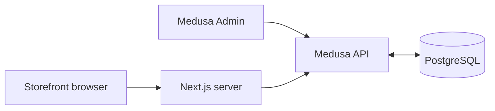

# Database and storefront

The local storefront at `http://localhost:3000` reads product content and prices from Medusa at `http://localhost:9000`. Edit products in **Medusa Admin → Products** at `http://localhost:9000/app`, save, then refresh the storefront page. A new server request reads current data; already open pages and prefetched browser navigation may need a refresh.



## Product fields

| Admin field | Storefront use |
|---|---|
| Title | Cards, product heading, bag and commission email piece name |
| Subtitle | Short text on the product page |
| Description | Artwork story on product pages, commission cards and tee quick-add |
| Thumbnail | Product image; first image is used when no thumbnail is set |
| Tee variant INR prices | Tee card/product price; the bag uses actual Medusa line amounts |
| Metadata `painting` | Artwork attribution |
| Metadata `manifestation`, `story`, `character`, `palette` | Supporting display fields; subtitle/description take precedence |

The current tee policy requires six sizes (`XS`, `S`, `M`, `L`, `XL`, `XXL`) at one equal positive INR price. An incomplete price setup causes a catalog error rather than showing an old local price. Manage all six prices together. Shipping, tax and inventory rules still require approval before checkout opens.

## Visibility and stable links

- **Tees:** publish the product, link it to **BAETEE Online**, and set metadata `kind` to `tee` and `legacy_id` to a unique positive integer. Set status to Draft or remove the channel to hide it. Stable storefront URL: `/product/tee/<legacy_id>`.
- **Paintings:** use metadata `kind: painting`, `commission_only: true`, `storefront_visible: true`, and a unique positive integer `legacy_id`. Link to **BAETEE Online**. URL: `/product/painting/<legacy_id>`.
- **Collectibles:** use `kind: collectible` and the same commission fields. URL: `/product/baetee/<legacy_id>`.
- Commission items can remain **Draft**, with no priced variants. Their explicit visibility flag opts their display content into the public commission catalog. Set `storefront_visible` to **false** or remove the sales channel to hide a piece. Rejected/proposed statuses are hidden too. Use JSON booleans for these metadata flags.
- Keep `legacy_id` stable after sharing links. IDs can extend beyond the original 15 products. Duplicate IDs within a collection cause an error.

`/store/baetee/commissions` requires a publishable key and its matching sales channel. It returns only display fields for opted-in commission products. It does not return arbitrary drafts, variants, prices, original metadata or internal notes. Never put private information in display fields.

The seed now fills missing commission metadata and links the original commission drafts to BAETEE Online on their first visibility upgrade. It preserves existing product text, images, prices, status and metadata values. Subsequent seeds preserve hidden flags and removed channels.

## Cart persistence

The anonymous cart and line amounts live in PostgreSQL. The browser holds an HTTP-only cart cookie. Refreshing a page reloads the same cart; another browser starts a different anonymous cart. Hidden tee lines remain visible in the bag with a removal action. Only current published tees can be added; checkout validates availability again.

## Configuration

The existing local connection is in ignored `.env.local`: `MEDUSA_BACKEND_URL`, `MEDUSA_PUBLISHABLE_KEY`, `MEDUSA_REGION_ID`, `PUBLIC_STORE_URL`. Database credentials stay in the backend environment. No PostgreSQL URL, Admin key or service-role key is sent to the browser.

For deployment, set these four values on Vercel to the Oracle backend, its production publishable key/India region, and the final storefront origin. Supabase PostgreSQL uses a private schema, dedicated role and verified TLS; Redis stays private on Oracle. See root `deploy.md` and `deployment-needed.md`. New gateway/email keys are not needed for local catalog and bag use.

The original catalog files remain seed input and an explicit preview fallback when all Medusa connection values are absent outside Vercel production. Vercel production requires its connection settings. A configured store fails on a database/API error; it does not silently use stale local content. Brand copy, artist biography, size-guide content and editorial hero photographs remain website assets.

## Verify locally

With both apps running and checkout disabled:

```powershell
cd D:\print\baetee\backend
npm run verify:catalog
cd ..
npm run verify:storefront
```

`verify:catalog` creates its own local tee and commission fixtures, uses the same product update workflow as Admin, checks changed titles/images/descriptions and visibility in server-rendered pages, checks private metadata is excluded, and removes an unavailable cart line. It deletes its fixture products in `finally`; it never edits real products or enables checkout. Development carts and soft-deleted fixture history remain in the local database. This is an HTTP integration check, not a browser interaction test.
